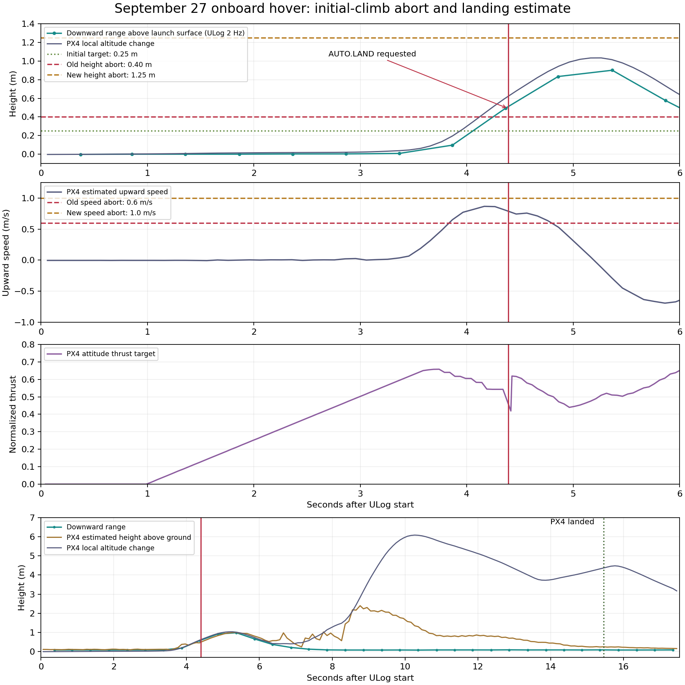

# OF_localise versus Demo_ASU_News: full branch and flight-parameter report

**Snapshot:** October 1, 2026. **Baseline:** [`Demo_ASU_News`](https://github.com/sangeetsu/cdrone_control/tree/Demo_ASU_News), commit `ddbde2aa1ac6d76baed9e13197e867431ba221d8`. **Compared branch:** `OF_localise`, HEAD `39d71a86c9fd379d4c5af51048fec4d8a2ac1727`. Both remote commit IDs were checked with `git ls-remote`. The working tree also contains uncommitted flight-limit fixes and this report.

## How to read the comparisons

Three sources answer different questions:

1. **Git baseline versus current working tree** identifies source and documentation changes. The committed branch has one new commit, with **25 changed files: 14 added and 11 modified**.
2. **Launch and ROS settings** identify what each launch path would configure by default. A launch default is not proof of the arguments used in a particular flight.
3. **PX4 parameter evidence** compares the latest ULog's `initial_parameters` with the repository's [`194_paramters.params`](../../194_paramters.params). That file is byte-identical on both Git branches and is the available tracked reference snapshot. It is **not a captured Demo_ASU_News flight log**, so differences from the latest ULog are confirmed changes in recorded FCU values relative to the snapshot, not proof that Git changed or applied those values. The ULog reflects the September 27 flight; it does not establish what is loaded on the FCU today.

The latest flight graph and analysis remain below. No FCU parameters were written during this report.

## Flight behavior and launch defaults

The baseline hover launch contains the external-pose demo. This branch adds an onboard ARK Flow route while keeping `localization_source:=external_pose` as the selector's default. The external-pose route still uses its original hover sequence, but **its default pose-frame rotation changed**.

| Setting or behavior | Demo_ASU_News default | OF_localise external-pose default | OF_localise onboard default |
| --- | --- | --- | --- |
| Localization path | External pose through OptiTrack bridge | `external_pose` | Select with `localization_source:=onboard`; MAVROS and PX4 local pose, no external-pose bridge or reference setup |
| Pose frame rotation, `frame_rpy_rad` | Identity `[0,0,0]` inherited by the bridge | `[0,0,π]` from `optitrack_defaults.yaml` and now forwarded by the hover launch | Not used by the onboard node |
| Takeoff altitude, m | 0.7 | 0.7 | 1.0 |
| Takeoff target ramp, m/s | 0.5 | 0.5 | 0.3 |
| Hover duration, s | 5 | 5 | 20 |
| Altitude tolerance, m | 0.10 | 0.10 | 0.15 |
| Horizontal excursion limit, m | 0.75 | 0.75 | 0.5 after position handover; no reliable XY perimeter during unaided initial climb |
| Setpoint publication, Hz | 20 | 20 | 20 |
| Flight enable gate | No onboard diagnostics gate | Legacy external-pose sequence still active | `enable_flight:=false` by default; explicit true plus start service needed to command flight |
| Takeoff/hover strategy | `AUTO_MODE` / `HOLD` | `AUTO_MODE` / `HOLD` | New OFFBOARD state machine; legacy strategy and hover-mode arguments are not used |
| Initial range-controlled climb | Not present | Not used | Optional, `initial_climb_enabled:=false` by default |

**The frame rotation is a substantive external-pose change.** The adapter applies the frame quaternion to both source position and orientation. A yaw rotation of π changes the signs of source X/Y and adds approximately 180° to orientation, before the separate body-orientation offset. The new `frame_rpy_rad` argument is passed through the hover, goto, circle, Milestone 2, and generic target-follow launches. The shared defaults file can also affect paths that read it without a changed launch file, including the external-pose bridge used by Milestones 3 and 4. The Milestone 4 VSLAM example explicitly supplies `[0,0,0]` to avoid applying this OptiTrack default to that source. Validate room-frame coordinates and safety boundaries before assuming a prior studio command has the same physical meaning.

### New onboard controller settings

These are all **36** `HoverSettings` defaults in the working tree. They have no onboard equivalent in the Demo_ASU_News branch. Launch exposes the principal mission and initial-climb settings; the remaining guards are node defaults unless separately supplied as ROS parameters.

| Group | Setting | Default | Effect |
| --- | --- | ---: | --- |
| Gate | `enable_flight` | false | Diagnostic mode until explicitly enabled |
| Mission | `publish_rate_hz` | 20 | Setpoint rate |
| Mission | `takeoff_altitude_m` | 1.0 | Final hover height relative to launch |
| Mission | `takeoff_rate_m_s` | 0.3 | Position-target climb ramp |
| Mission | `hover_duration_s` | 20 | Timer starts after altitude dwell |
| Mission | `altitude_tolerance_m` | 0.15 | Arrival band |
| Mission | `altitude_dwell_s` | 1 | Time in arrival band |
| Readiness | `readiness_dwell_s` | 2 | Continuous preflight readiness |
| Readiness | `offboard_warmup_s` | 1.5 | Setpoint stream before OFFBOARD |
| Readiness | `sensor_timeout_s` | 0.5 | Pose/flow/range/IMU freshness |
| Readiness | `state_timeout_s` | 2.5 | FCU state and estimator freshness |
| Guard | `max_horizontal_excursion_m` | 0.5 | Position-control XY limit |
| Guard | `max_pose_jump_m` | 0.5 | Pose-discontinuity limit |
| Guard | `max_yaw_jump_rad` | 0.52 | Yaw-discontinuity limit |
| Guard | `altitude_overshoot_m` | 0.3 | Position-control altitude guard |
| Guard | `stage_timeout_s` | 30 | Non-hover stage timeout |
| Guard | `landing_timeout_s` | 45 | Landing-confirmation timeout |
| Command | `command_timeout_s` | 2 | Service reply/target confirmation timeout |
| Command | `command_retry_s` | 1 | Minimum retry spacing |
| Command | `max_command_attempts` | 3 | Request-attempt limit |
| Sensor | `flow_min_quality` | 1 | ROS packet-quality floor; PX4 fusion checked separately |
| Sensor | `range_min_m` | 0.05 | ROS acceptance floor |
| Sensor | `range_max_m` | 30 | ROS acceptance ceiling |
| Initial climb | `initial_climb_enabled` | false | Opt-in unaided range climb |
| Initial climb | `initial_climb_hover_thrust` | 0.0 | Must be set to a verified airframe value when enabled; flight example uses 0.62 |
| Initial climb | `initial_climb_max_thrust` | 0.75 | Thrust ceiling |
| Initial climb | `initial_climb_thrust_slew` | 0.25 | Maximum increase in normalized thrust per second |
| Initial climb | `initial_climb_height_m` | 0.25 | Initial target above launch surface |
| Initial climb | `initial_climb_max_height_m` | 1.25 | Hard height abort; uncommitted fix after last flight |
| Initial climb | `initial_climb_rate_m_s` | 0.2 | Commanded climb-speed cap |
| Initial climb | `initial_climb_min_range_m` | 0.15 | Minimum corrected range for handover |
| Initial climb | `initial_climb_aiding_dwell_s` | 1 | Stable aiding required before handover |
| Initial climb | `initial_climb_timeout_s` | 8 | Overall initial-climb timeout |
| Initial climb | `initial_climb_no_lift_timeout_s` | 5 | No-lift timeout |
| Initial climb | `initial_climb_max_tilt_rad` | 0.2 | Attitude guard |
| Initial climb | `initial_climb_max_speed_m_s` | 1.0 | Measured vertical-speed abort; uncommitted change from 0.6 |

The working-tree fix raises two abort thresholds only. It does not change the 0.25 m target, controller gains, 0.2 m/s commanded climb cap, handover criteria, or timeouts. A second abort request during landing now preserves the first fault and original landing timeout.

### Interfaces and MAVROS behavior

| Area | Baseline | This branch |
| --- | --- | --- |
| New hover services | None for the onboard controller | `/cdrone/<id>/demo/position_hover_check`, `..._start`, `..._abort` |
| New status topics | None for the onboard controller | `/cdrone/<id>/demo/position_hover_state` and `..._diagnostics` |
| Sensor inputs | External-pose bridge | MAVROS state, landed state, estimator status, local pose, optical-flow packets, downward range; IMU and PX4 position-target echo when initial climb is enabled |
| Control outputs | Legacy position/mode flow | OFFBOARD attitude/thrust setpoints during initial climb, then position setpoints after confirmed handover; `AUTO.LAND` on completion or abort |
| MAVROS plugin denylist | Guided target, wheel odometry, odometry | Onboard overlay also denies fake GPS, mocap pose, vision pose, and vision speed injection |
| MAVROS PX4Flow range metadata | 0.3–5 m, frame `px4flow`, field of view 0.118682 | Onboard overlay: 0.05–30 m, frame `ark_flow_downward`, field of view 0.2164; optional downward `DISTANCE_SENSOR` mapping |
| MAVROS configuration mechanism | Fixed parameter layers in `drone.launch.py` | Optional `mavros_config_overlay` appended as the last layer; default empty, onboard path supplies the new overlay |
| Telemetry request | Existing MAVROS behavior | Onboard node requests local pose, flow, range, estimator and landed-state streams; initial climb also requests position-target echo |

The MAVROS overlay changes ROS-side acceptance and plugins. It does **not** set PX4 parameters. The [new inspector](../../scripts/inspect_onboard_localization.py) reads FCU settings/telemetry, can save an operator backup, and can print proposed PX4 console commands; the operator must review/apply the profile and reboot separately. No code path automatically applies the profile on launch.

## PX4 profile and recorded flight parameters

### Intended onboard PX4 profile versus latest ULog

[`onboard_optical_flow_profile.yaml`](../../ros2/src/drone_bringup/config/onboard_optical_flow_profile.yaml) defines **18** PX4 parameters. The latest ULog matches **16** and differs on the two minimum sensor heights:

| PX4 parameter | Profile | Latest ULog | Comparison |
| --- | ---: | ---: | --- |
| `UAVCAN_ENABLE` | 2 | 2 | Match |
| `UAVCAN_SUB_FLOW` | 1 | 1 | Match |
| `UAVCAN_SUB_RNG` | 1 | 1 | Match |
| `EKF2_OF_CTRL` | 1 | 1 | Match |
| `EKF2_EV_CTRL` | 0 | 0 | Match |
| `EKF2_GPS_CTRL` | 0 | 0 | Match |
| `EKF2_BARO_CTRL` | 1 | 1 | Match |
| `EKF2_HGT_REF` | 0 | 0 | Match |
| `EKF2_RNG_CTRL` | 1 | 1 | Match |
| `EKF2_RNG_A_HMAX` | 10 | 10 | Match |
| `EKF2_RNG_QLTY_T` | 0.2 | 0.2 | Match |
| `UAVCAN_RNG_MIN` | 0.08 | 0.05 | **Mismatch** |
| `UAVCAN_RNG_MAX` | 30 | 30 | Match |
| `SENS_FLOW_MINHGT` | 0.08 | 0.05 | **Mismatch** |
| `SENS_FLOW_MAXHGT` | 25 | 25 | Match |
| `SENS_FLOW_MAXR` | 7.4 | 7.4 | Match |
| `COM_OBL_RC_ACT` | 4 | 4 | Match |
| `COM_OF_LOSS_T` | 1 | 1 | Match |

The branch's profile uses barometric height reference and conditional range aiding, disables external-vision fusion, and enables CAN flow/range. The latest flight used the lower 0.05 m minimums despite the tracked profile's 0.08 m values. This mismatch is separate from the logged initial-climb height abort.

### Latest ULog versus the tracked 194 snapshot

Of **1,074** named values in the shared tracked snapshot and **1,073** in the latest ULog, **1,065** names overlap. Among shared names, **998 values are exactly equal** and **67 are unequal**: **61 differ beyond** a relative/absolute tolerance of `1e-6` and **6 differ only within that floating-point tolerance**. Another **9 names appear only in the snapshot** and **8 only in the ULog**. The complete **84-row** list is in [Appendix B](#appendix-b-complete-parameter-difference-list) and [CSV](assets/px4_parameters_194_vs_log0341.csv).

| Parameter group | Tracked 194 snapshot | Latest flight ULog | Why it matters |
| --- | ---: | ---: | --- |
| `EKF2_EV_CTRL` | 11 | 0 | External-vision fusion setting changed |
| `EKF2_HGT_REF` | 3 | 0 | Height reference changed from EV setting to barometric setting |
| `EKF2_BARO_CTRL` | 0 | 1 | Barometer fusion enabled |
| `EKF2_RNG_CTRL` | 0 | 1 | Range aiding enabled |
| `EKF2_RNG_A_HMAX` | 5 | 10 | Range-aiding upper height changed |
| `EKF2_RNG_QLTY_T` | 1 | 0.2 | Range-quality timing changed |
| `UAVCAN_SUB_FLOW` / `UAVCAN_SUB_RNG` | 0 / 0 | 1 / 1 | CAN flow and range subscriptions enabled |
| `COM_OBL_RC_ACT` | 0 | 4 | OFFBOARD-loss action changed; profile labels value 4 “Land” |
| `MPC_THR_HOVER` | 0.56 | 0.62 | Airframe hover-thrust estimate differs; runbook example uses 0.62 |
| `MPC_XY_CRUISE` | 5 | 0.5 | PX4 horizontal cruise setting is one tenth of snapshot |
| `MPC_XY_VEL_MAX` | 12 | 7 | PX4 maximum XY velocity reduced |
| `MPC_VEL_MANUAL` | 10 | 0.5 | Manual velocity setting reduced |
| `MPC_XY_VEL_ALL` | -10 | -0.5 | All-mode XY velocity setting changed |
| `BAT_LOW_THR` / `BAT_CRIT_THR` / `BAT_EMERGEN_THR` | 0.15 / 0.07 / 0.05 | 0.35 / 0.15 / 0.10 | Battery alert thresholds increased |
| `COM_RC_LOSS_T` | 0.5 | 5 | RC-loss timeout increased |
| `COM_LOW_BAT_ACT` | 0 | 3 | Low-battery action setting changed |
| `GF_ACTION` | 2 | 5 | Geofence action setting changed |

Other changed fields include calibration offsets/scales, RC/arming/navigation settings, GPS port configuration, and flight counters. These are enumerated in Appendix B. **Do not restore calibration or safety values from the reference snapshot wholesale**: the report identifies differences and does not establish which set is correct for the current hardware. The latest ULog and 194 snapshot agree on `MPC_TKO_SPEED=1.5`, `MPC_LAND_SPEED=0.7`, `MIS_TAKEOFF_ALT=1.0`, `EKF2_OF_CTRL=1`, `EKF2_GPS_CTRL=0`, and `COM_OF_LOSS_T=1`. Their inclusion here prevents assuming those values changed.

### Added historical PX4 backups

The branch adds four time-stamped parameter snapshots. They are historical evidence, not a launch profile or the latest FCU state. Counts below compare only names shared with `194_paramters.params`; missing-name counts reflect incomplete/different snapshot coverage.

| Added file under `backup/` | Parsed names | Different shared values vs 194 | Names absent from 194 | 194 names absent from backup |
| --- | ---: | ---: | ---: | ---: |
| `current_params_before_194_restore_20260908T002144Z.params` | 943 | 53 | 4 | 135 |
| `current_params_before_194_restore_20260908T003948Z.params` | 943 | 1 | 4 | 135 |
| `current_params_before_5th_aug_restore_20260907T234013Z.params` | 900 | 202 | 1 | 175 |
| `current_params_before_direct_194_restore_20260908T010608Z.params` | 818 | 102 | 7 | 263 |

The first 194-restore backup records `MPC_THR_HOVER≈0.60` and `MPC_XY_CRUISE=1.5`; the second is nearly identical to 194 among shared values and records `MPC_THR_HOVER≈0.56` and `MPC_XY_CRUISE=5`. The other two represent different partial parameter states. The latest ULog, rather than any backup filename, is the evidence for the September 27 flight values.

## Complete tracked-file inventory

Every file in `git diff --name-status Demo_ASU_News..OF_localise` is listed here. “Added” and “modified” refer to the committed branch delta. Working-tree additions are listed afterward.

| File | Git status | Exact role or changed behavior |
| --- | --- | --- |
| `backup/current_params_before_194_restore_20260908T002144Z.params` | Added | Historical FCU snapshot before a 194 restore attempt |
| `backup/current_params_before_194_restore_20260908T003948Z.params` | Added | Second historical snapshot before a 194 restore attempt |
| `backup/current_params_before_5th_aug_restore_20260907T234013Z.params` | Added | Historical snapshot before an August-parameter restore |
| `backup/current_params_before_direct_194_restore_20260908T010608Z.params` | Added | Historical snapshot before direct MAVLink 194 restore |
| `docs/milestones/milestone4.md` | Modified | Adds optical-flow migration constraints and explicit zero-frame VSLAM example |
| `milestone1_runbook.md` | Modified | Adds onboard setup, profile inspection, readiness, flight, initial-climb and rollback procedures; retains legacy mocap instructions |
| `ros2/src/drone_bringup/config/onboard_mavros.yaml` | Added | Onboard plugin denylist and ARK Flow range metadata/mapping |
| `ros2/src/drone_bringup/config/onboard_optical_flow_profile.yaml` | Added | Operator-reviewed 18-value PX4 1.16 flow/range/EKF/OFFBOARD profile |
| `ros2/src/drone_bringup/config/optitrack_defaults.yaml` | Modified | Sets default `frame_rpy_rad=[0,0,π]` |
| `ros2/src/drone_bringup/launch/drone.launch.py` | Modified | Accepts optional last-layer `mavros_config_overlay` |
| `ros2/src/drone_bringup/launch/milestone2_demo.launch.py` | Modified | Forwards configurable frame rotation to external-pose bridge |
| `ros2/src/drone_bringup/launch/position_circle_demo.launch.py` | Modified | Forwards configurable frame rotation to external-pose hover path |
| `ros2/src/drone_bringup/launch/position_goto_demo.launch.py` | Modified | Forwards configurable frame rotation to external-pose bridge |
| `ros2/src/drone_bringup/launch/position_hover_demo.launch.py` | Modified | Selects onboard or external-pose stack; adds onboard arguments and source-specific hover defaults; forwards frame rotation |
| `ros2/src/drone_bringup/launch/target_follow.launch.py` | Modified | Forwards configurable frame rotation to external-pose bridge |
| `ros2/src/drone_bringup/launch/vslam_px4_bridge.launch.py` | Modified | Adds a frame-rotation argument, default identity, and forwards it |
| `ros2/src/drone_control_pkg/drone_control_pkg/onboard_hover_demo_sequence_node.py` | Added | MAVROS subscriptions/services, telemetry validation, setpoint publishing and diagnostics |
| `ros2/src/drone_control_pkg/drone_control_pkg/onboard_hover_logic.py` | Added | Readiness, OFFBOARD state machine, abort and landing logic |
| `ros2/src/drone_control_pkg/drone_control_pkg/onboard_initial_climb.py` | Added | Tilt-corrected range and bounded thrust loop for initial climb |
| `ros2/src/drone_control_pkg/setup.py` | Modified | Registers onboard hover executable |
| `ros2/src/drone_control_pkg/test/test_onboard_hover.py` | Added | State-machine and safety tests |
| `ros2/src/drone_control_pkg/test/test_onboard_hover_transport.py` | Added | ROS/MAVROS boundary and launch tests |
| `ros2/src/drone_control_pkg/test/test_onboard_initial_climb.py` | Added | Initial-climb dynamics, handover and guard tests |
| `ros2/src/drone_control_pkg/test/test_onboard_profile.py` | Added | Profile and configuration tests |
| `scripts/inspect_onboard_localization.py` | Added | Read-only FCU profile/telemetry inspection and printable commands |

The working tree modifies the runbook, hover launch, hover logic and three tests, and adds this report, [flight graph](assets/initial_climb_2026-09-27.png), [parameter CSV](assets/px4_parameters_194_vs_log0341.csv), [graph script](../../scripts/plot_initial_climb_report.py), and [parameter comparison script](../../scripts/compare_px4_param_snapshot.py). The runbook already had an uncommitted example enabling initial climb with `initial_climb_hover_thrust:=0.62` before the flight-limit fixes; that example remains.

## September 27 flight and current validation status

The latest available flight is the host-side `LOG0341` ULog. Its FCU filename says `2026-08-25/02_54_06.ulg`; the FCU clock date differs from the September 27 Jetson ROS log. The paired ROS node log identifies `INITIAL_CLIMB`, then **`initial climb height limit exceeded`**. The node requested `AUTO.LAND`, PX4 recorded the external mode command, and no completed hover was logged.

| Seconds after ULog start | Evidence |
| ---: | --- |
| 1.406 | PX4 commander detected takeoff. |
| 4.366 | Optical-flow range 0.578 m, about 0.494 m above the initial 0.084 m range; the then-active height abort was 0.40 m above launch. |
| 4.390–4.410 | MAVROS requested `AUTO.LAND`, then PX4 changed mode. |
| 5.366 | Logged range peaked at 0.985 m, about 0.901 m above the launch reading, after landing was requested. |
| 7.855 onward | Downward range returned near 0.08–0.09 m, while PX4's height estimates disagreed. |
| 15.457 | PX4 marked landed; disarm followed at about 16.545 s. |

At about 10.265 s, PX4 local altitude had shifted roughly 6.1 m relative to its launch reading while downward range was near ground clearance. PX4 also logged IMU acceleration clipping at 6.397–6.406 s. The logs do not establish physical altitude or why the estimator diverged. Near-ground range alone does not prove touchdown; PX4's landed indication arrived later. The preceding `LOG0340` attempt aborted in `INITIAL_CLIMB` for **`initial climb vertical speed limit exceeded`**. The new 1.25 m height limit exceeds the logged range-derived climb, while the new 1.0 m/s speed limit exceeds the approximately 0.87 m/s upward PX4 velocity estimate. The speed guard uses filtered range-derived speed, which can differ from PX4's estimate; these comparisons cannot prove either guard would pass on a repeat flight. Settling at the 0.25 m target and successful handover remain unvalidated.

| Capability | Current status | Next work |
| --- | --- | --- |
| Onboard ARK Flow hover | Code built; focused onboard tests passed; **full flight validation pending** | Resolve range/local-altitude and landing-detection discrepancy, inspect FCU/profile mismatch, then supervise handover, full hover, landing and disarm |
| Milestone 1 goto/circle | Still studio-frame, external-pose demos | Define drift-aware local goals and safe boundaries only after hover is validated |
| Milestone 2 target servicing | Existing tracker/controller remain tied to external-pose ownship and studio perimeter | Adapt ownship/world-track frame and boundary semantics; bench-test before flight |
| Milestone 3 ground-start sequence | Takeoff, staging, return and landing remain tied to external-pose frame | Integrate validated onboard takeoff/handover and drift-aware return/abort behavior |
| Milestone 4 target memory | Default target-map frame remains OptiTrack studio map | Handle estimator resets, track-history frame consistency, perimeter and return behavior before onboard flight |

Optical flow provides a drifting local frame. It does not establish the studio map or pillar coordinates, so migrating the remaining milestones requires coordinated changes to localization, target coordinates, and safety behavior.

**Verification:** `colcon build --packages-select drone_control_pkg drone_bringup` completed; the focused hover, initial-climb, transport and profile suite passed **92 tests**; `git diff --check` passed. This is software verification, not a flight result.

## Appendix B: complete parameter difference list

This table includes every exactly unequal shared name and every one-sided name when comparing `194_paramters.params` with `LOG0341`. Values are rounded for display except for precision-only rows; the [CSV](assets/px4_parameters_194_vs_log0341.csv) carries 17 significant digits. “Precision-only” means the exact recorded numbers differ but are equal at relative/absolute tolerance `1e-6`. “Snapshot only” or “flight only” means the parameter was absent from one source, not that a branch removed or created it. Calibration values and flight counters are listed for completeness, not as recommended settings.

| Category | Parameter | 194 snapshot | LOG0341 | Comparison |
| --- | --- | ---: | ---: | --- |
| Battery | BAT_CRIT_THR | 0.0700000003 | 0.150000006 | value changed |
| Battery | BAT_EMERGEN_THR | 0.0500000007 | 0.100000001 | value changed |
| Battery | BAT_LOW_THR | 0.150000006 | 0.349999994 | value changed |
| Calibration | CAL_ACC0_XOFF | -0.0842566192 | 0.0447081663 | value changed |
| Calibration | CAL_ACC0_YOFF | -0.051904574 | -0.148343951 | value changed |
| Calibration | CAL_ACC0_ZOFF | 0.0773451254 | -0.0207121409 | value changed |
| Calibration | CAL_ACC1_XOFF | -0.00510787964 | 0.0504693985 | value changed |
| Calibration | CAL_ACC1_YOFF | 0.0347852707 | -0.0272593498 | value changed |
| Calibration | CAL_ACC1_ZOFF | 0.0572423935 | -0.0376386642 | value changed |
| Calibration | CAL_ACC2_XOFF | -0.0038485527 | 0.0851511955 | value changed |
| Calibration | CAL_ACC2_YOFF | 0.00488853455 | 0.0346298218 | value changed |
| Calibration | CAL_ACC2_ZOFF | -0.0199947357 | -0.0371742249 | value changed |
| Calibration | CAL_GYRO0_XOFF | -0.00167654199 | -0.00373079325 | value changed |
| Calibration | CAL_GYRO0_YOFF | -0.00972216018 | -0.0168868471 | value changed |
| Calibration | CAL_GYRO0_ZOFF | -0.00182266568 | 0.00363625749 | value changed |
| Calibration | CAL_GYRO1_XOFF | -0.00963526312 | -0.00260453648 | value changed |
| Calibration | CAL_GYRO1_YOFF | -0.0273281932 | -0.00318997493 | value changed |
| Calibration | CAL_GYRO1_ZOFF | -0.0027248587 | 0.0166117605 | value changed |
| Calibration | CAL_GYRO2_XOFF | 0.0158978384 | 0.0175216664 | value changed |
| Calibration | CAL_GYRO2_YOFF | -0.000351210037 | -0.0410339162 | value changed |
| Calibration | CAL_GYRO2_ZOFF | -0.00551850069 | 0.00283377524 | value changed |
| Calibration | CAL_GYRO3_XOFF | -0.000143815123 | -5.27162447e-05 | value changed |
| Calibration | CAL_GYRO3_YOFF | 0.00060994894010946198 | 0.00060994894010946155 | precision-only |
| Calibration | CAL_GYRO3_ZOFF | 6.31372823e-05 | 5.80617489e-05 | value changed |
| Calibration | CAL_MAG0_XODIAG | 0.0194538143 | -0.00667014718 | value changed |
| Calibration | CAL_MAG0_XOFF | -0.07075537 | -0.0540239029 | value changed |
| Calibration | CAL_MAG0_XSCALE | 1.03041184 | 1.03616297 | value changed |
| Calibration | CAL_MAG0_YODIAG | 0.00710023614 | 0.0105751706 | value changed |
| Calibration | CAL_MAG0_YOFF | 0.0792606771 | 0.0838157758 | value changed |
| Calibration | CAL_MAG0_YSCALE | 0.987515867 | 0.979335546 | value changed |
| Calibration | CAL_MAG0_ZODIAG | 0.00253736437 | -0.0125302253 | value changed |
| Calibration | CAL_MAG0_ZOFF | 0.0449310429 | 0.307139009 | value changed |
| Calibration | CAL_MAG0_ZSCALE | 0.972946703 | 1.00463295 | value changed |
| Calibration | SENS_BOARD_X_OFF | 0.182564363 | 0.00985711534 | value changed |
| Calibration | SENS_BOARD_Y_OFF | -1.76823485 | -0.559445024 | value changed |
| Commander / navigation | COM_ARM_WO_GPS | 1 | 2 | value changed |
| Commander / navigation | COM_FLIGHT_UUID | 61 | 249 | value changed |
| Commander / navigation | COM_FLTMODE2 | -1 | 11 | value changed |
| Commander / navigation | COM_LOW_BAT_ACT | 0 | 3 | value changed |
| Commander / navigation | COM_OBL_RC_ACT | 0 | 4 | value changed |
| Commander / navigation | COM_RC_IN_MODE | 4 | 3 | value changed |
| Commander / navigation | COM_RC_LOSS_T | 0.5 | 5 | value changed |
| Commander / navigation | CP_DIST | -1 | 5 | value changed |
| Commander / navigation | GF_ACTION | 2 | 5 | value changed |
| Commander / navigation | GPS_1_CONFIG | 201 | 0 | value changed |
| Commander / navigation | GPS_1_GNSS | 0 | — | snapshot only |
| Commander / navigation | GPS_1_PROTOCOL | 1 | — | snapshot only |
| Commander / navigation | GPS_DUMP_COMM | 0 | — | snapshot only |
| Commander / navigation | GPS_SAT_INFO | 0 | — | snapshot only |
| Commander / navigation | GPS_UBX_BAUD2 | 230400 | — | snapshot only |
| Commander / navigation | GPS_UBX_CFG_INTF | 0 | — | snapshot only |
| Commander / navigation | GPS_UBX_MODE | 0 | — | snapshot only |
| Commander / navigation | GPS_YAW_OFFSET | 0 | — | snapshot only |
| Commander / navigation | NAV_DLL_ACT | 0 | 3 | value changed |
| Commander / navigation | NAV_RCL_ACT | 2 | 3 | value changed |
| Commander / navigation | SER_GPS1_BAUD | 0 | — | snapshot only |
| Estimator / sensors | EKF2_BARO_CTRL | 0 | 1 | value changed |
| Estimator / sensors | EKF2_EV_CTRL | 11 | 0 | value changed |
| Estimator / sensors | EKF2_GYR_B_NOISE | 0.0010000000474974511 | 0.0010000000474974513 | precision-only |
| Estimator / sensors | EKF2_HGT_REF | 3 | 0 | value changed |
| Estimator / sensors | EKF2_MAG_B_NOISE | 9.9999997473788004e-05 | 9.9999997473787516e-05 | precision-only |
| Estimator / sensors | EKF2_MAG_E_NOISE | 0.0010000000474974511 | 0.0010000000474974513 | precision-only |
| Estimator / sensors | EKF2_RNG_A_HMAX | 5 | 10 | value changed |
| Estimator / sensors | EKF2_RNG_CTRL | 0 | 1 | value changed |
| Estimator / sensors | EKF2_RNG_QLTY_T | 1 | 0.200000003 | value changed |
| Estimator / sensors | SENS_FLOW_MAXHGT | — | 25 | flight only |
| Estimator / sensors | SENS_FLOW_MAXR | — | 7.4000001 | flight only |
| Estimator / sensors | SENS_FLOW_MINHGT | — | 0.0500000007 | flight only |
| Estimator / sensors | SENS_FLOW_RATE | — | 70 | flight only |
| Estimator / sensors | SENS_FLOW_ROT | — | 0 | flight only |
| Estimator / sensors | SENS_FLOW_SCALE | — | 1 | flight only |
| Estimator / sensors | UAVCAN_RNG_MAX | — | 30 | flight only |
| Estimator / sensors | UAVCAN_RNG_MIN | — | 0.0500000007 | flight only |
| Estimator / sensors | UAVCAN_SUB_FLOW | 0 | 1 | value changed |
| Estimator / sensors | UAVCAN_SUB_RNG | 0 | 1 | value changed |
| Motion | MPC_THR_HOVER | 0.560000002 | 0.620000005 | value changed |
| Motion | MPC_VEL_MANUAL | 10 | 0.5 | value changed |
| Motion | MPC_XY_CRUISE | 5 | 0.5 | value changed |
| Motion | MPC_XY_VEL_ALL | -10 | -0.5 | value changed |
| Motion | MPC_XY_VEL_MAX | 12 | 7 | value changed |
| Other | INA226_SHUNT | 0.00050000002374872598 | 0.00050000002374872565 | precision-only |
| Other | LND_FLIGHT_T_HI | 0 | 2 | value changed |
| Other | LND_FLIGHT_T_LO | -1.93409342e+09 | 487830077 | value changed |
| Other | MC_PITCHRATE_D | 0.0035670381039381032 | 0.0035670381039381027 | precision-only |

## Reproduction and evidence

- Baseline: `git diff origin/Demo_ASU_News --`; remote refs verified with `git ls-remote origin refs/heads/Demo_ASU_News refs/heads/OF_localise`.
- Flight ULog: `/home/jetson/.local/share/logloader/logs/LOG0341_2026-08-25T02:54:24Z.ulg`, SHA-256 `8ef5a4f85048af29c2a82fc2bce6247fe1fe03541b49ba0d22d4fed08f3ad2f7`.
- ROS log: `/home/jetson/.ros/log/python3_11801_1790470485823.log`, SHA-256 `94b056d9e285bb060c7ed4254ff11020e3ee5bc00bb0ac1b86276ccef8a62634`.
- Plot: `python3 scripts/plot_initial_climb_report.py <flight.ulg> docs/reports/assets/initial_climb_2026-09-27.png`.
- Parameter comparison: `python3 scripts/compare_px4_param_snapshot.py 194_paramters.params <flight.ulg> docs/reports/assets/px4_parameters_194_vs_log0341.csv`.
